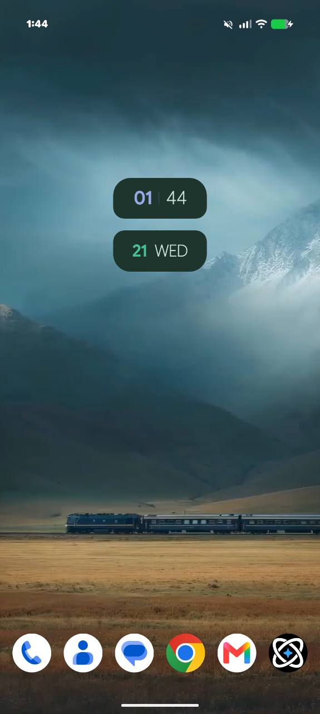
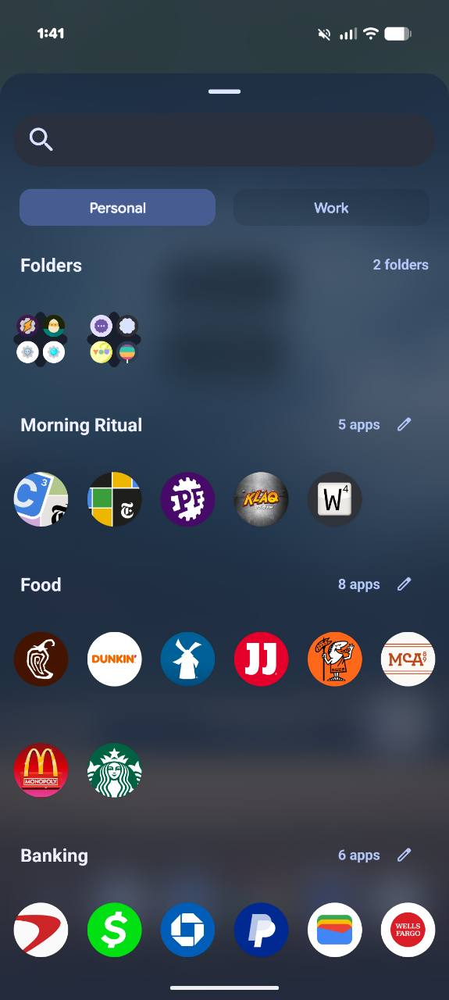
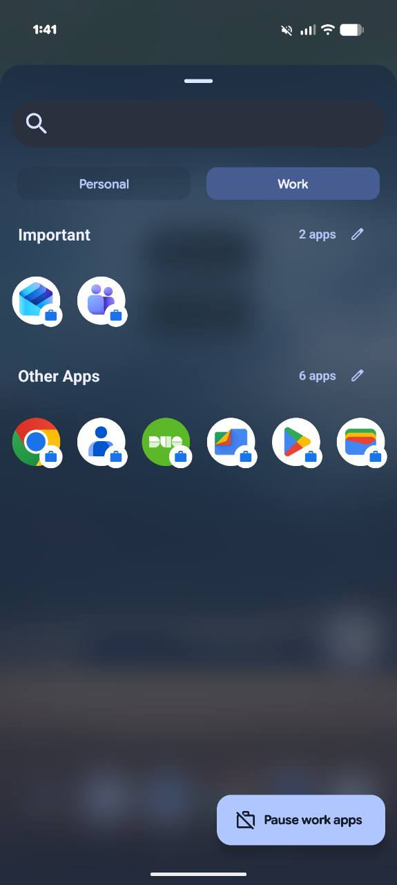
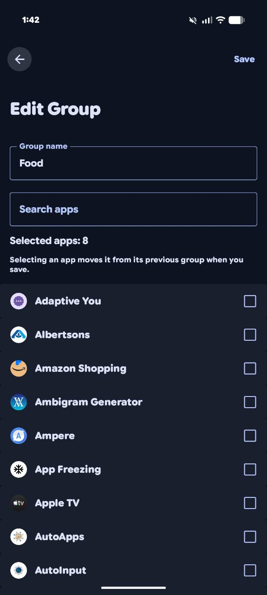
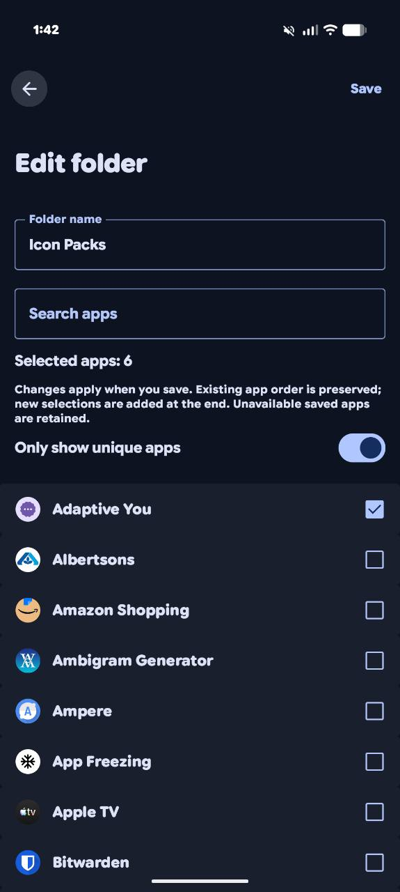
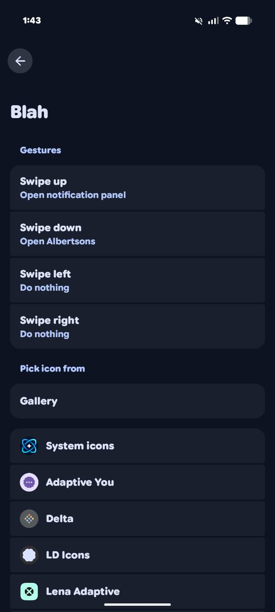

  

<h1 align="center">Vega Launcher</h1>

Bringing back the Nova Launcher features we love, with a Vega touch.

Based on Lawnchair 16 and Android's Launcher3.

Vega Launcher is a personal project with a simple goal: bring our favorite Nova Launcher features into a modern Android home that feels like our own. From organizing apps with groups and folders to custom icons, hidden apps, and backup and restore, we're building the controls and familiar touches we love, one feature at a time.

Built on Lawnchair 16 and Android's Launcher3, Vega adds its own identity, a native clock and date widget, and thoughtfully chosen defaults. Nova Launcher is our inspiration; Vega is an independent project and is not affiliated with Nova Launcher.

**Download:** [Get the latest Vega Launcher APK](https://github.com/BigDaddyBubba37/vega-launcher-releases/releases/latest). This public repository contains releases and user information; source development remains private.

## New in Vega 0.1.3

- Compatible **1×1 dock widgets**, including improved Tasker V2 configuration, taps, sizing and live updates.
- **Work profile setup/status** directly on the main Vega Settings page; existing profiles disable setup.
- **Private Space search** appears first after typing **priva**, with Android setup/unlock on supported devices.
- Fixed the Private Space hide-toggle crash and made the search keyboard open on the **first tap**.
- About has a **What’s new** link that opens the latest features and fixes in a scrollable popup.

Read the [full 0.1.3 release notes](https://github.com/BigDaddyBubba37/vega-launcher-releases/releases/tag/v0.1.3), including Android compatibility and testing limits. Fresh profile creation still needs wider device testing. Android retains authentication and automatic-lock control; on devices that restrict the hide preference, locked Private Space stays hidden and searchable.

## Screenshots

A look at Vega Launcher on a real device. Tap a screenshot to see it full size.

<table>
  <tr>
    <td align="center" width="50%"><strong>Home screen</strong>   Native Vega clock and date widget with a six-icon dock.</td>
    <td align="center" width="50%"><strong>Folders and groups</strong>   Drawer folders at the top, followed by named groups and direct-edit pencils.</td>
  </tr>
  <tr>
    <td align="center" width="50%"><strong>Work profile</strong>   Separate Work tab, custom groups, and briefcase badges.</td>
    <td align="center" width="50%"><strong>Edit a group</strong>   Rename, search, and select apps with an explicit Save action.</td>
  </tr>
  <tr>
    <td align="center" width="50%"><strong>Edit a folder</strong>   Searchable app selection, folder naming, and duplicate filtering.</td>
    <td align="center" width="50%"><strong>Folder gestures and icons</strong>   Assign four swipe directions and choose custom folder icons.</td>
  </tr>
</table>

Screenshots show an example setup. Wallpaper, fonts, icon packs, and installed apps can vary; third-party artwork and apps shown are not bundled with Vega.

## New and enhanced in Vega

### App drawer groups and folders

- **Expanded vertical groups** in one continuous scrolling drawer, with visible headings and app counts.
- **Manage Groups** to create, rename, delete, reorder, and assign apps with searchable multi-selection and an explicit Save action.
- Each app belongs to at most one custom group; unassigned apps appear in **Other Apps**, always last.
- A small **pencil beside the app count** opens that group's editor directly. The Other Apps pencil opens Manage Groups.
- Saved drawer folders appear in their own **Folders section above the groups**. The section is omitted entirely when there are no eligible folders to display.
- Folder contents, ordering, and saved group assignments are preserved. The existing setting for hiding apps contained in folders also applies to the group listings below them.
- Live drawer updates when group or folder configuration changes.
- Work-profile app icons retain their **briefcase badges**. Private Space stays in its separate protected presentation.

### Hide Apps

- A dedicated selection screen for hiding and unhiding multiple apps.
- A direct **Hide App** action on eligible drawer and prediction icons.
- Hidden apps are excluded from drawer listings, groups, drawer app search, and drawer predictions.
- Saved hidden selections survive restarts and are included in backup and restore.
- Hiding changes launcher visibility; it does not uninstall or disable an app.

### Backup and restore

- Restores home-screen and dock layouts, folders, app placements, launcher preferences, and customization settings.
- Includes custom drawer groups, hidden-app selections, and registered assets such as custom folder images.
- Validates and stages restore data, then installs it before launcher storage initializes.
- Preserves custom folder-image associations through restoration.
- Exports suggested filenames as **VegaLauncher_Backup <date/time>.lawnchairbackup**.
- Widget placements are included; Android may require widget rebinding or configuration. External live-wallpaper applications and their state are not supplied by a Vega backup.

### Native Vega Clock & Date widget

- A native, resizable **2×2 clock and date widget** with two dark-green panels, lavender/green accents, and a minimal four-part display.
- Uses Android TextClock updates for time and date, including timezone and locale handling and system 12/24-hour settings.
- Supports resizing and launcher/device restarts, with backup and restore integration.
- Includes the widget-resize protection retained in Vega's launcher code.

### Fresh-install home screen

New workspaces start with a **6-column × 10-row grid**, the native Vega clock centered near the upper third, and this six-icon dock:

**Phone → Contacts → Messages → Chrome → Gmail → Vega Settings**

Google apps are preferred; suitable installed equivalents are used where supported. Missing or ambiguous apps leave their slots empty.

The initial preset also includes smaller icons, a six-column drawer, hidden home/drawer icon labels, disabled Smartspace and global predictions, and the accepted folder, notification-dot, and menu styling. It includes a Vega Launcher drawer group for the launcher and Settings entries.

Defaults apply only to genuinely fresh storage. **Existing, upgraded, and restored layouts are preserved.** The reference preset does not bundle a wallpaper image.

### Vega identity and settings

- Dedicated Vega application IDs, artwork, and branding.
- A separate **Vega Settings** drawer/dock entry with **white rings, a blue center star, and a transparent background**.
- A redesigned About page with Vega's star/meadow/launcher definitions, pronunciation actions, version information, and Lawnchair attribution.
- Lawnchair promotional announcement cards and the development warning removed from the settings dashboard; useful system notices retained.
- Automatic Lawnchair release checks and the obsolete Updater settings disabled. Production **Vega Updates** checks this public repository for signed updates. Open it from General settings or by tapping the version on About. The 0.1.0 to 0.1.1 update was successfully tested by the project owner.

### Custom folder icons

Vega retains its custom folder-icon selection and caching, including gallery images and supported icon sources. Folder-image assets and their folder associations are included in manual backup and restore.

## Built on Lawnchair

Vega retains the underlying launcher customization infrastructure, including icon packs, fonts, colors, search, and supported profile handling. Private Space search opens Android setup where supported or the existing authenticated unlock flow. Android remains responsible for profile security and automatic locking.

Quickstep integration remains dependent on the supported Android version and device setup. It is not required for ordinary home-screen use.

## Download and install

1. Open [the latest release](https://github.com/BigDaddyBubba37/vega-launcher-releases/releases/latest).
2. Under **Assets**, download **VegaLauncher-<version>.apk**.
3. Open the APK and allow installation from your browser or file manager if Android asks.
4. Select **Vega Launcher** as your default home app.

Requires **Android 8.0 or newer**. Production updates preserve the existing app installation; Android asks you to confirm installation. Debug builds use a separate app identity.

Vega is under active development. Compatibility with every device, Android version, widget provider and profile configuration has not been established.

## Credits

Vega builds on [Lawnchair](https://github.com/LawnchairLauncher/lawnchair) and Android Launcher3. Credit and applicable licenses remain with their respective authors. Nova Launcher provides inspiration; Vega is an independent project.
