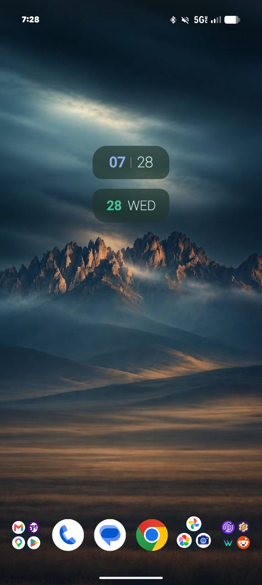
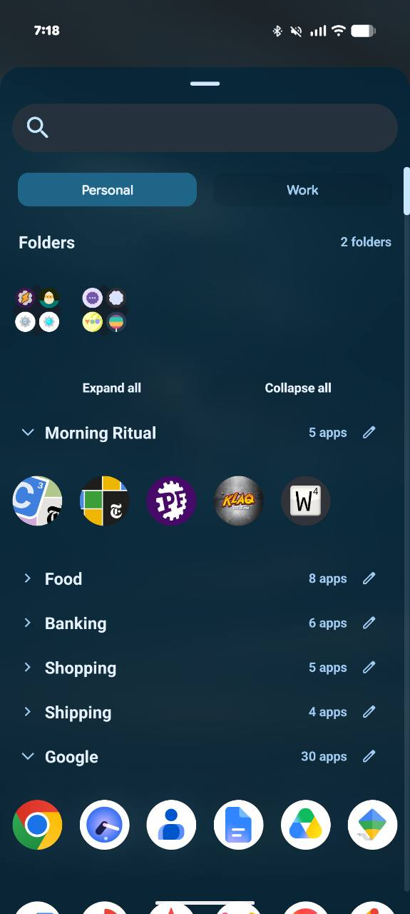
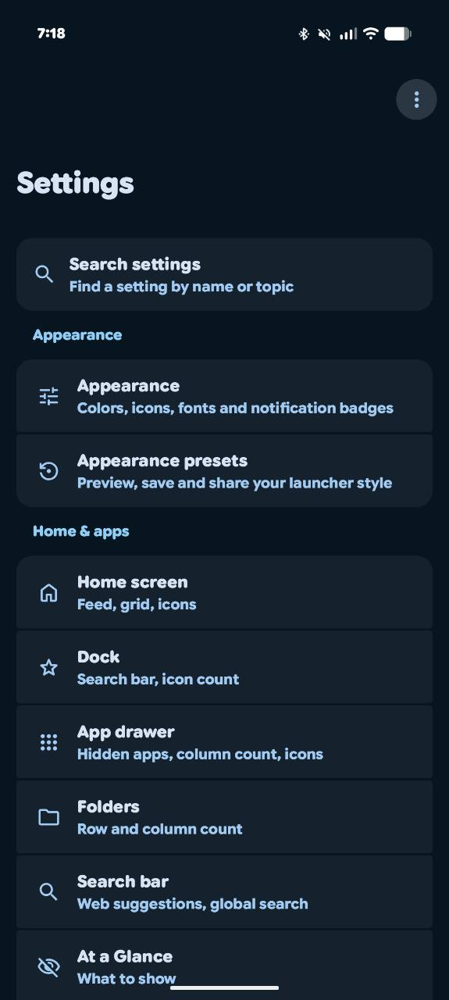
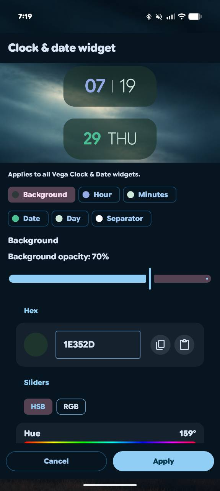

  

<h1 align="center">Vega Launcher</h1>

Bringing back the Nova Launcher features we love, with a Vega touch.

Based on Lawnchair 16 and Android's Launcher3.

Vega Launcher is a personal project with a simple goal: bring our favorite Nova Launcher features into a modern Android home that feels like our own. From organizing apps with groups and folders to custom icons, hidden apps, and backup and restore, we're building the controls and familiar touches we love, one feature at a time.

Built on Lawnchair 16 and Android's Launcher3, Vega adds its own identity, a native clock and date widget, and thoughtfully chosen defaults. Nova Launcher is our inspiration; Vega is an independent project and is not affiliated with Nova Launcher.

**Public APK downloads are temporarily paused during licensing and source-distribution review.** Historical release pages remain available for reference. Existing installations keep working; this pause does not change their data. A replacement public build and its matching source will be announced after review. Source development remains private.

[Historical release pages](https://github.com/BigDaddyBubba37/vega-launcher-releases/releases)

**Source review:** [Download the reviewed current source snapshot](https://github.com/BigDaddyBubba37/vega-launcher-releases/releases/tag/source-7e686a3bc3fa). This snapshot includes current application code and updated legal notices; it is not a source match for every historical release. Public APK downloads remain paused.

## New in Vega 0.1.5

- **Widget stacks** for home screens and popup gestures, with 2–5 widgets, manual navigation and transparent home content.
- **Tasker events and saved-layout switching**, with explicit authorization, recovery and a 60-second switch cooldown.
- **Backup library, restore preview, scheduled backups and saved layouts**.
- **Settings search and Setup and diagnostics** for easier navigation and setup.
- **Collapsible drawer groups, folder covers and configurable notification badges**.
- Fixed drawer-folder taps and stack Settings/loading issues.

Home-stack loading and transparent appearance are user-accepted. Popup stacks, live restore/rebinding and broader device/provider coverage remain pending.

Read the [full 0.1.5 release notes](https://github.com/BigDaddyBubba37/vega-launcher-releases/releases/tag/v0.1.5) for setup, update compatibility and testing limits.

Public debug downloads are paused with the other historical APKs.

## Previously in Vega 0.1.4

- **Tasker actions:** lock the phone, lock Private Space or pause Work, with explicit authorization for each configuration.
- **Optional Vega wallpaper:** preview the mountain-and-train still before choosing it, at first installation or later in Home screen settings.
- **Clearer feed setup:** guided AIDL Bridge installation, provider detection and improved reconnection.
- **Better older-device support:** fixes for startup, the clock/date widget, work-profile activation and unwanted home menus after swipe-unlock.
- **75% drawer opacity by default:** existing saved and restored settings remain unchanged.
- Updated **What's new** popup under the About information, preserving Vega's definitions and styling.

Read the [full 0.1.4 release notes](https://github.com/BigDaddyBubba37/vega-launcher-releases/releases/tag/v0.1.4) for setup, compatibility and tested scope. The project owner confirmed all three Tasker actions and LG work-profile/clock/unlock fixes; wider device and provider testing continues. Android retains profile authentication and policy control.

## Previously in Vega 0.1.3

- Compatible **1×1 dock widgets**, including improved Tasker V2 configuration, taps, sizing and live updates.
- **Work profile setup/status** directly on the main Vega Settings page; existing profiles disable setup.
- **Private Space search** appears first after typing **priva**, with Android setup/unlock on supported devices.
- Fixed the Private Space hide-toggle crash and made the search keyboard open on the **first tap**.
- About has a **What’s new** link that opens the latest features and fixes in a scrollable popup.

Read the [full 0.1.3 release notes](https://github.com/BigDaddyBubba37/vega-launcher-releases/releases/tag/v0.1.3), including Android compatibility and testing limits. Fresh profile creation still needs wider device testing. Android retains authentication and automatic-lock control; on devices that restrict the hide preference, locked Private Space stays hidden and searchable.

## Screenshots

Screenshots from the current Vega testing build. Colors, fonts and layouts are customizable; some features shown are newer than public version 0.1.5. Select an image to view it at full size.

<table>
  <tr>
    <td align="center"><strong>Home screen</strong> </td>
    <td align="center"><strong>App drawer</strong> </td>
  </tr>
  <tr>
    <td align="center"><strong>Settings</strong> </td>
    <td align="center"><strong>Widget colors</strong> </td>
  </tr>
</table>

## New and enhanced in Vega

### App drawer groups and folders

- **Expanded vertical groups** in one continuous scrolling drawer, with visible headings and app counts.
- **Manage Groups** to create, rename, delete, reorder, and assign apps with searchable multi-selection and an explicit Save action.
- Each app belongs to at most one custom group; unassigned apps appear in **Other Apps**, always last.
- A small **pencil beside the app count** opens that group's editor directly. The Other Apps pencil opens Manage Groups.
- Saved drawer folders appear in their own **Folders section above the groups**. The section is omitted entirely when there are no eligible folders to display.
- Folder contents, ordering, and saved group assignments are preserved. The existing setting for hiding apps contained in folders also applies to the group listings below them.
- Live drawer updates when group or folder configuration changes.
- Work-profile app icons retain their **briefcase badges**. Private Space stays in its separate protected presentation.

### Hide Apps

- A dedicated selection screen for hiding and unhiding multiple apps.
- A direct **Hide App** action on eligible drawer and prediction icons.
- Hidden apps are excluded from drawer listings, groups, drawer app search, and drawer predictions.
- Saved hidden selections survive restarts and are included in backup and restore.
- Hiding changes launcher visibility; it does not uninstall or disable an app.

### Backup and restore

- Restores home-screen and dock layouts, folders, app placements, launcher preferences, and customization settings.
- Includes custom drawer groups, hidden-app selections, and registered assets such as custom folder images.
- Validates and stages restore data, then installs it before launcher storage initializes.
- Preserves custom folder-image associations through restoration.
- Exports suggested filenames as **VegaLauncher_Backup <date/time>.lawnchairbackup**.
- Widget placements are included; Android may require widget rebinding or configuration. External live-wallpaper applications and their state are not supplied by a Vega backup.

### Native Vega Clock & Date widget

- A native, resizable **2×2 clock and date widget** with two dark-green panels, lavender/green accents, and a minimal four-part display.
- Uses Android TextClock updates for time and date, including timezone and locale handling and system 12/24-hour settings.
- Supports resizing and launcher/device restarts, with backup and restore integration.
- Includes the widget-resize protection retained in Vega's launcher code.

### Fresh-install home screen

New workspaces start with a **6-column × 10-row grid**, the native Vega clock centered near the upper third, and this six-icon dock:

**Phone → Contacts → Messages → Chrome → Gmail → Vega Settings**

Google apps are preferred; suitable installed equivalents are used where supported. Missing or ambiguous apps leave their slots empty.

The initial preset also includes smaller icons, a six-column drawer, hidden home/drawer icon labels, disabled Smartspace and global predictions, and the accepted folder, notification-dot, and menu styling. It includes a Vega Launcher drawer group for the launcher and Settings entries.

Defaults apply only to genuinely fresh storage. **Existing, upgraded, and restored layouts are preserved.** An optional bundled Vega wallpaper preview lets you choose the mountain-and-train still or keep your current wallpaper. Open Home screen settings to preview it later.

### Vega identity and settings

- Dedicated Vega application IDs, artwork, and branding.
- A separate **Vega Settings** drawer/dock entry with **white rings, a blue center star, and a transparent background**.
- A redesigned About page with Vega's star/meadow/launcher definitions, pronunciation actions, version information, and Lawnchair attribution.
- Lawnchair promotional announcement cards and the development warning removed from the settings dashboard; useful system notices retained.
- Automatic Lawnchair release checks and the obsolete Updater settings disabled. Production **Vega Updates** checks this public repository for signed updates. Open it from General settings or by tapping the version on About. The 0.1.0 to 0.1.1 update was successfully tested by the project owner.

### Custom folder icons

Vega retains its custom folder-icon selection and caching, including gallery images and supported icon sources. Folder-image assets and their folder associations are included in manual backup and restore.

## Tasker actions

In Tasker, choose **Plugin → Vega Launcher → Configuration**, select **Lock phone**, **Lock Private Space** or **Pause Work profile**, then **Save and authorize**. Configure each action separately. Phone locking needs Vega's existing accessibility or screen-lock administrator permission. Private Space requires Android 15+; Work pause requires Android 9+. Vega must be the default home app for profile actions; put Tasker's **Go Home** first if needed, and lock the phone last when combining actions. Work pause stops work apps and notifications rather than imposing a separate credential lock. After reinstalling or moving devices, open and save Tasker configurations again.

## Google feed setup

Open **Vega Settings → Home screen → Show feed**. Production builds require a compatible bridge when direct access is unavailable. Follow Vega's **Get AIDL Bridge** link, install the bridge, return to settings and select the available provider. Stock Lawnfeed may not authorize Vega's production package. Feed behavior depends on Google and device compatibility.

## Built on Lawnchair

Vega retains the underlying launcher customization infrastructure, including icon packs, fonts, colors, search, and supported profile handling. Private Space search opens Android setup where supported or the existing authenticated unlock flow. Android remains responsible for profile security and automatic locking.

Quickstep integration remains dependent on the supported Android version and device setup. It is not required for ordinary home-screen use.

## Download and install

1. Open [the latest release](https://github.com/BigDaddyBubba37/vega-launcher-releases/releases/latest).
2. Under **Assets**, download **VegaLauncher-<version>.apk**.
3. Open the APK and allow installation from your browser or file manager if Android asks.
4. Select **Vega Launcher** as your default home app.

Requires **Android 8.0 or newer**. Production updates preserve the existing app installation; Android asks you to confirm installation. Debug builds use a separate app identity.

Vega is under active development. Compatibility with every device, Android version, widget provider and profile configuration has not been established.

## Credits

Vega builds on [Lawnchair](https://github.com/LawnchairLauncher/lawnchair) and Android Launcher3. Credit and applicable licenses remain with their respective authors. Nova Launcher provides inspiration; Vega is an independent project.

## Licensing and source

Vega’s combined launcher distribution uses GNU GPL version 3 or, at your option, a later version. Original Apache, MIT, BSD and OFL component notices remain in place. Recipients may modify and redistribute under the applicable terms. The development repository and its Git history remain private; published source snapshots are public.

[GNU GPLv3 text](https://www.gnu.org/licenses/gpl-3.0.en.html) · [Current application source review](https://github.com/BigDaddyBubba37/vega-launcher-releases/releases/tag/source-7e686a3bc3fa) · [Dependency source companion](https://github.com/BigDaddyBubba37/vega-launcher-releases/releases/tag/source-dependencies-892a517d21c2)

Public APK downloads remain paused. Historical APK/source matching is still being checked against the original build records; the current source snapshot is not presented as a source match for every older release.
